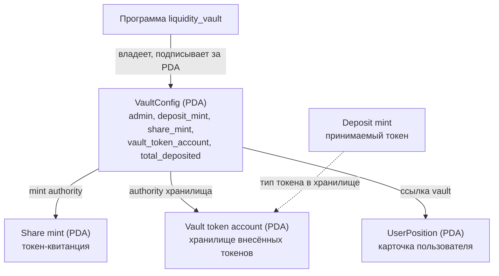

# Liquidity Vault — Неделя 8: каркас vault (РК1)

Учебный DeFi-проект на Solana (Anchor). Vault принимает токены пользователей в общий
«котёл» и выдаёт взамен share-токены — квитанции с долей в котле.
На этой неделе сделан **каркас**: денег ещё нет, есть только структура аккаунтов.

## Главная идея

Программа сама владеет деньгами. Хранилище токенов и право выпускать share-токены
принадлежат **PDA** — адресу без приватного ключа, которым может распоряжаться только
программа. Поэтому ни администратор, ни кто-то другой не может просто забрать токены.

## Схема аккаунтов



| Аккаунт | Seeds (PDA) | Кто владеет / управляет | Что хранит |
|---|---|---|---|
| VaultConfig | `["vault", admin, deposit_mint]` | программа | админ, принимаемый токен, share-токен, адрес хранилища, всего внесено |
| Share mint | `["share_mint", vault_config]` | mint authority = VaultConfig | токен-квитанция (выпускает только программа) |
| Vault token account | `["vault_token", vault_config]` | authority = VaultConfig | физически лежащие внесённые токены |
| UserPosition | `["position", vault_config, user]` | программа | владелец, vault, сколько внёс пользователь |

Карточку пользователя всегда можно найти: её адрес вычисляется из адреса vault и адреса
пользователя, список всех пользователей хранить не нужно.

## Инструкции

- `create_vault` — один раз создаёт VaultConfig, share mint и хранилище. Подписывает и платит rent администратор.
- `open_position` — пользователь создаёт свою карточку (UserPosition).

## Как запустить

```bash
anchor build
anchor deploy
npm install
npx ts-node --transpile-only vault_client.ts
```

Клиент создаёт тестовый токен (если его ещё нет), vault и карточку, затем читает аккаунты
из блокчейна и проверяет, что владельцем хранилища и mint authority является VaultConfig.
Повторный запуск безопасен: уже созданные аккаунты пропускаются.

## Адреса в Devnet

| Аккаунт | Адрес |
|---|---|
| Программа | [81Twbdtp8aSVkfUi3MRmjTAQgsCggdsWiAr2QiU3CDP1](https://explorer.solana.com/address/81Twbdtp8aSVkfUi3MRmjTAQgsCggdsWiAr2QiU3CDP1?cluster=devnet) |
| Deposit mint | [ByFz2f7xPUg9R6FVmKB34iknoFxTzR3eFmAooJT9iHCH](https://explorer.solana.com/address/ByFz2f7xPUg9R6FVmKB34iknoFxTzR3eFmAooJT9iHCH?cluster=devnet) |
| VaultConfig (PDA) | [2o6cc8tAxRwd2YqPHa7nLg8W3CSUNcLqrVBWePDSMU6o](https://explorer.solana.com/address/2o6cc8tAxRwd2YqPHa7nLg8W3CSUNcLqrVBWePDSMU6o?cluster=devnet) |
| Share mint (PDA) | [35mUhB6k3WgNqMTmxAnT151veqRDnbCtScrVFTQL3Mk9](https://explorer.solana.com/address/35mUhB6k3WgNqMTmxAnT151veqRDnbCtScrVFTQL3Mk9?cluster=devnet) |
| Vault token account (PDA) | [JBSzFVAgdEaT22rhqx4sBsEVULVnmJ4EMZNpneY2u42P](https://explorer.solana.com/address/JBSzFVAgdEaT22rhqx4sBsEVULVnmJ4EMZNpneY2u42P?cluster=devnet) |
| UserPosition (PDA) | [CRM3TqM3SeHiT6kYMEs6kQGTobd6PfMXPWkA2YYTAy58](https://explorer.solana.com/address/CRM3TqM3SeHiT6kYMEs6kQGTobd6PfMXPWkA2YYTAy58?cluster=devnet) |

## Транзакции

- create_vault: https://explorer.solana.com/tx/4iph5dX6rDDGAhSPQLyYAMtxYEvtu4iL811NGQ9weWXQtcYRTqWkjqJHNYSubSU3rdZHCj5o34JbtEMyMyakUZTP?cluster=devnet
- open_position: https://explorer.solana.com/tx/T5qRfAMMTfCi2djjiDCTmbjL44Kth4vGTwBDDwqz1rgZPAA6TGs3UX9x86VWZshzCCb3uAdt8WUvXbTD2JrLqQr?cluster=devnet


## Безопасность

В репозитории нет файлов ключей и seed-фраз. Работаем только в devnet.
`target/` и `node_modules/` в `.gitignore`.